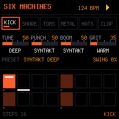

# SIX MACHINES

A performance drum machine for the M-VAVE FM-1 by **swtdr34mz**, in the spirit of the Elektron boxes (Syntakt,
Model:Cycles) and the Erica Synths LXR-02. Built on [fm1-base](https://github.com/charlesvestal/fm1-base) and
[felucca-bsp](https://github.com/hugelton/felucca-bsp).

Six synthesized drum machines. Every knob is a **macro**: it moves several parameters at once, each along its own
curve, and it rests on **sweetspots**. Turn a knob slowly and it stops for a few detents on each sweetspot, whose name
lights up. Turn it fast and it runs past them. Wherever a knob stands, the sound works.

 

## Version 0.1: the first machine, KICK

| Knob | Macro | Moves | Sweetspots |
| --- | --- | --- | --- |
| K1 | **TUNE** | the tone (30 to 80 Hz), the sweep's length, the deep tail | SUB (D1), DEEP (G1), 808 (A1), TIGHT (C2) |
| K2 | **PUNCH** | the pitch sweep's depth and time, the click | SOFT, SYNTAKT, TECHNO, ZAP |
| K3 | **BOOM** | the body's length, the deep tail, the 808 glide down | TIGHT, SYNTAKT, 808, DRONE |
| K4 | **GRIT** | drive, wavefolder, tone, bitcrusher, at an even loudness | CLEAN, WARM, RUMBLE, FOLD, DESTROY |

The macros are coupled: a high kick sweeps shorter, a low kick gets more of the deep tail, a long body driven hard is
turned down a little. GRIT changes the character, not the level (measured to within about 1 dB).

Presets (PRESET): SYNTAKT DEEP, 808 CLASSIC, WAREHOUSE, PSY ZAP.

## Controls

| Control | What it does |
| --- | --- |
| White keys | The 16 steps: a tap turns a step on, again ACCENT, again off |
| Black keys | The six machines, left to right. KICK plays the kick now; SNARE, TOMS, METAL, HATS and CLAP are coming |
| K1..K4 | The machine's four macros |
| SELECT | Tempo (60 to 200 BPM) |
| ALGORITHM | Swing |
| PRESET | A start preset for the four knobs |
| PLAY | Start from step 1 / stop |
| REC held 1 s | Clears the pattern |
| OCT- / OCT+ | The kick's level |

Settings, the pattern and the knobs save themselves a few seconds after the last change.

## Roadmap

1. KICK and the 16-step sequencer (this version)
2. SNARE and HATS
3. METAL (FM cymbals), TOMS, CLAP
4. Sequencer: 32 steps, parameter locks, trig conditions, retrigs
5. Per track: SAT, ENV, LFO and MIX pages
6. Master: compressor, saturation, tilt EQ, reverb and delay
7. Performance FX: filter, beat repeat, tape stop, throws, build-up, kills, scenes
8. The screen and the intro

## Building

    git clone --recursive https://github.com/swtdr34mz-afk/SIX_MACHINES
    X0X_FONTSET=terminus python3 fm1-base/tools/build.py . --host
    build/host/sixmachines_host tests/basic.txt build/host

GitHub Actions builds the installable `.fwsc` on every push (Actions tab > the run > Artifacts). A tag `v0.1` makes a
release with it.

## Licence

MPL-2.0. All code of SIX MACHINES is its own; fm1-base and felucca-bsp are MPL-2.0 too. See [CREDITS.md](CREDITS.md).
