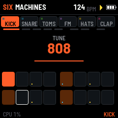
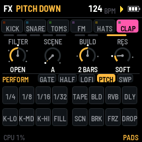

# SIX MACHINES

A performance drum machine for the M-VAVE FM-1 by **swtdr34mz**, in the spirit of the Elektron boxes (Syntakt,
Model:Cycles) and the Erica Synths LXR-02. Built on [fm1-base](https://github.com/charlesvestal/fm1-base) and
[felucca-bsp](https://github.com/hugelton/felucca-bsp).

Six synthesized drum machines. Every knob is a **macro**: it moves several parameters at once, each along its own
curve, and it rests on **sweetspots**. Turn a knob slowly and it stops for a few detents on each sweetspot, whose name
lights up. Turn it fast and it runs past them. Wherever a knob stands, the sound works.

 

## MIDI out: SIX MACHINES leads

While it plays, SIX MACHINES sends **MIDI clock** (24 a quarter, at its tempo) with **START** and **STOP**, and the
**KICK's hits as note 36 on channel 10**, over USB: to a computer, or to another FM-1 that plays USB host.
With [STRANGER SYNTH](https://github.com/swtdr34mz-afk/STRANGER_SYNTH) (LINK on its SAVE button) its arp, its heartbeat
and its sidechain follow SIX MACHINES: connect this FM-1 to its USB port with an OTG cable or adapter (the port gives no
power: this one runs on its battery or through a powered hub). New in v0.1.5, with the FM drum.

## The six machines

| Machine | K1 | K2 | K3 | K4 | Presets |
| --- | --- | --- | --- | --- | --- |
| **KICK** (sine, pitch sweep, click, drive, folder) | TUNE: SUB, DEEP, 808, TIGHT | PUNCH: SOFT, SYNTAKT, TECHNO, ZAP | BOOM: TIGHT, SYNTAKT, 808, DRONE | GRIT: CLEAN, WARM, RUMBLE, FOLD, DESTROY | SYNTAKT DEEP, 808 CLASSIC, WAREHOUSE, PSY ZAP |
| **SNARE** (tuned body + noise band) | TUNE: FAT, SYNTAKT, TIGHT, PICCOLO | SNAP: BRUSH, SYNTAKT, CRACK, RIMSHOT | BODY: NOISY, SYNTAKT, FAT, TONE | RATTLE: DRY, SYNTAKT, TRAP, GATED, DIRT | SYNTAKT SD, TRAP SNARE, GATED 80S, RIMSHOT |
| **TOMS** (bent membrane, FM skin) | TUNE: FLOOR, LOW, HIGH, TIMBAL | BEND: FLAT, SYNTAKT, DROP, SIMMONS | DECAY: SHORT, SYNTAKT, RING, BOOM | SKIN: SOFT, SYNTAKT, WOOD, METAL | SYNTAKT TOM, FLOOR BOOM, SIMMONS, WOOD BLOCK |
| **FM** (an FM drum as the DrumBrute Impact's, turning into FM metal) | PITCH: SUB, LOW, MID, HIGH | MOD: 1:1, 1.41, 2:1, BELL, then the metal: RIDE, CRASH, INDUSTRY | AMOUNT: PURE, SOFT, GROWL, NOISE (in the metal: its shimmer) | DECAY: BLIP, PERC, TONE, DRONE (short ones drop in pitch: the minimal blip) | MINIMAL BLIP, FM TOM, FM RIDE, FM CRASH |
| **HATS** (808 metal + noise) | TUNE: LOW, 808, HIGH, TINY | DECAY: TICK, CLOSED, HALF, OPEN, WASH | METAL: NOISE, SYNTAKT, 808, RING | CRISP: SOFT, CRISP, SIZZLE, HARSH | SYNTAKT HH, 808 HAT, OPEN WASH, TICK |
| **CLAP** (hands, rim, cowbell) | TUNE: LOW, 909, 808, HIGH | SPREAD: SINGLE, TIGHT, 909, CROWD | ROOM: DRY, SHORT, ROOM, HALL | MORPH: CLAP, RIM, COWBELL | 909 CLAP, 808 CLAP, RIM CLICK, COWBELL |

The macros are coupled (a high kick sweeps shorter, a high snare or tom rings shorter, the hats' and the metal's
filters follow their pitch, the FM's short decays drop in pitch), and the character knobs keep the loudness even (measured).

## Pages

Each machine has five pages of four knobs; the master has three. Every knob has its sweetspots.

| Button | Page | K1 | K2 | K3 | K4 |
| --- | --- | --- | --- | --- | --- |
| HOME | **SOUND** (the machine) | its four macros | | | |
| SEL | **SAT** | TYPE: TAPE, TUBE, FOLD, CRUSH | AMOUNT: OFF, LIGHT, HOT, MAX | TONE: DARK, OPEN, BRIGHT | MIX: DRY, HALF, WET |
| ENV | **ENV** (modulates a macro at each hit) | DEPTH: -MAX .. OFF .. +MAX | ATTACK: SNAP, SOFT, SWELL, SLOW | DECAY: SHORT, MID, LONG, HOLD | TARGET: the machine's K1..K4 |
| LFO | **LFO** (synced to the tempo) | RATE: 4 BARS, 1 BAR, 1/4, 1/8, 1/16 | DEPTH: -MAX .. OFF .. +MAX | WAVE: SINE, TRI, SAW, SQUARE, S&H | TARGET: the machine's K1..K4 |
| EDIT | **MIX** | LEVEL: SOFT, MIX, FULL, HOT | PAN: LEFT .. CENTER .. RIGHT | REVERB: DRY, TOUCH, ROOM, WET, DROWN | DELAY: DRY, TOUCH, ECHO, WET, DUB |
| FX | **MASTER** | COMP: OFF, GLUE, PUNCH, PUMP (ducks under the kick) | WARMTH: CLEAN, TAPE, HOT, CRUSHED | TILT: DARK, FLAT, BRIGHT | SPACE (reverb): ROOM, PLATE, HALL, CAVE |
| FX again | **DELAY** (ping-pong) | TIME: 1/16, 1/8, 3/16, 1/4 | FEEDBK: SHORT, ECHO, DUB, LOOP | TONE: DARK, TAPE, CLEAR | RETURN (reverb and delay): OFF, LOW, MIX, LOUD |
| GLO | **PERFORM** | FILTER (DJ): LP MAX, LP, OPEN, HP, HP MAX | SCENE: A, HALF, B | BUILD (its length): 1, 2, 4 BARS | RES: SOFT, ACID, SCREAM |

The same page button again goes back to SOUND. A bar under the rack shows the eight pages (the machine's five, the
master's two on FX, PERFORM) with the one shown thick; on FX its name says 1/2 or 2/2. On the SOUND page a white mark on
a knob's bar shows where its ENV and LFO move it now.

### ENV

ENV moves one of the machine's four macros (TARGET) at every hit: DEPTH says how far (up or down; in the middle, OFF,
nothing happens), ATTACK how fast it gets there (SNAP: already on the hit), DECAY how fast it comes back. Examples:
KICK, TARGET TUNE, DEPTH +MAX, DECAY SHORT: a harder pitch zap; SNARE, TARGET RATTLE, DEPTH +HALF, DECAY LONG: a
rattle that opens at each hit; FM, TARGET MOD, DEPTH -HALF, ATTACK SWELL: a blip that sweeps into its ratio.

## Presets

A preset is a machine's whole sound: its SOUND, SAT, ENV and LFO pages (the MIX page, the mixer, stays as it is).
PRESET turns through the machine's four presets and its **USER** presets. A sound changed since its preset was loaded
shows a * after the preset's name, and the first turn of PRESET asks **SAVE SOUND?**: SAVE keeps it as a USER preset
(four a machine, kept apart from the patterns), PRESET again lets the change go. **HOME held 1 s** brings the machine's
sound back to its preset.

## The sequencer

- **Steps:** the white keys are the picked machine's 16 steps. A tap turns a step on, again ACCENT, again off.
- **32 steps:** SEQ switches 16 / 32 (the first time, the first 16 are copied into the second half). OCT- / OCT+
  show steps 1-16 / 17-32.
- **Parameter locks:** hold a step and turn K1..K4 (SOUND page): the step plays with those values, the next trig
  without. A white dot marks a locked step. Hold a step and turn PRESET: its locks are gone.
- **Trig conditions:** hold a step and turn SELECT: ALWAYS, 1:2, 2:2, 1:4, 2:4, 3:4, 4:4, 50%, 25%, 75%, FILL,
  NOT FILL, FIRST.
- **Retrigs:** hold a step and turn ALGORITHM: 1 to 4 hits in the step, each a little softer.
- **Mutes:** SEQ held + a black key.

## Performance

**ARP** turns PERF mode on (as the LXR-02's): the six machines' keys become **mutes** (a press mutes, the next
unmutes; a muted machine's key goes dark), the 16 white keys become pads, and the five black keys right of the machines
become **live FX**, each active while held.

| Black key | Live FX |
| --- | --- |
| 7 | GATE: a trance gate, the sound chopped in thirty-seconds |
| 8 | HALF TIME: the beat at half speed, back in time when let go |
| 9 | LO-FI: a quarter of the sample rate, 6 bits |
| 10 | PITCH DOWN: every machine tuned down |
| 11 | SWEEP: a low-pass closing over a bar, opening in a beat when let go |

The white pads:

| Pad | | Pad | |
| --- | --- | --- | --- |
| 1 | REPEAT 1/4 | 9 | KILL LOW |
| 2 | REPEAT 1/8 | 10 | KILL MID |
| 3 | REPEAT 1/16 | 11 | KILL HIGH |
| 4 | REPEAT 1/32 | 12 | FILL (the FILL conditions play) |
| 5 | TAPE STOP (let go: it comes back in) | 13 | SCENE B (morph to it while held) |
| 6 | BUILD-UP (a snare roll, a rising high-pass; let go: the drop) | 14 | BREAK (no kick) |
| 7 | REVERB THROW | 15 | FREEZE (the delay holds its loop) |
| 8 | DELAY THROW | 16 | DROP (from the top, at once) |

**Scenes:** SAVE stores scene B: the six machines' SOUND as they are. The SCENE knob (PERFORM page) morphs every machine
from its sound to scene B; pad 13 jumps there while held. SAVE held 1 s forgets scene B.

## Controls

| Control | What it does |
| --- | --- |
| Black keys | The six machines: KICK, SNARE, TOMS, FM, HATS, CLAP. A key picks the machine; while the sequencer is stopped it also plays it. PERF mode: mutes |
| White keys | The picked machine's steps (PERF mode: the pads) |
| K1..K4 | The page's four knobs |
| SELECT | Tempo (60 to 200 BPM); SEQ held: swing; a step held: its condition |
| ALGORITHM | DRIVE: the master's compressor and warmth as one macro (OFF, GLUE, PUNCH, PUMP, CRUSH); a step held: its retrigs |
| PRESET | The picked machine's presets (asks SAVE SOUND? when the sound was changed); a step held: its locks cleared |
| HOME held 1 s | The machine's sound back to its preset |
| HOME, SEL, ENV, LFO, EDIT, FX, GLO | The pages |
| ARP | PERF mode: the machines' keys mute, the white keys are pads, the black keys 7-11 live FX |
| SEQ | 16 / 32 steps; held + a black key: a mute |
| OCT- / OCT+ | Steps 1-16 / 17-32 |
| SAVE | Scene B stored; held 1 s: gone. While SAVE SOUND? asks: the sound kept as a USER preset |
| PLAY | Start from step 1 / stop |
| REC held 1 s | Clears the picked machine's pattern |

The bottom line shows the audio load (CPU %) and, should the sound ever break up, the dropouts. The machines are
rendered on both of the FM-1's cores (TOMS, FM, HATS and CLAP on the second); if the second core fails on a unit,
everything runs on the first.

Settings, patterns, pages, scene B and the USER presets save themselves once the sequencer stops (writing the flash while it plays would make the sound drop out); mutes and pads are live.

## Building

    git clone --recursive https://github.com/swtdr34mz-afk/SIX_MACHINES
    X0X_FONTSET=barlow python3 fm1-base/tools/build.py . --host
    build/host/sixmachines_host tests/basic.txt build/host

GitHub Actions builds the installable `.fwsc` on every push (Actions tab > the run > Artifacts). A tag `v0.1.0` makes a
release with it.

## Licence

MPL-2.0. All code of SIX MACHINES is its own; fm1-base and felucca-bsp are MPL-2.0 too. See [CREDITS.md](CREDITS.md).
