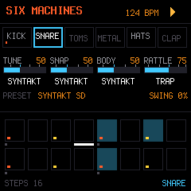

# SIX MACHINES

A performance drum machine for the M-VAVE FM-1 by **swtdr34mz**, in the spirit of the Elektron boxes (Syntakt,
Model:Cycles) and the Erica Synths LXR-02. Built on [fm1-base](https://github.com/charlesvestal/fm1-base) and
[felucca-bsp](https://github.com/hugelton/felucca-bsp).

Six synthesized drum machines. Every knob is a **macro**: it moves several parameters at once, each along its own
curve, and it rests on **sweetspots**. Turn a knob slowly and it stops for a few detents on each sweetspot, whose name
lights up. Turn it fast and it runs past them. Wherever a knob stands, the sound works.

 

## Version 0.2: KICK, SNARE, HATS

**KICK**

| Knob | Macro | Moves | Sweetspots |
| --- | --- | --- | --- |
| K1 | **TUNE** | the tone (30 to 80 Hz), the sweep's length, the deep tail | SUB (D1), DEEP (G1), 808 (A1), TIGHT (C2) |
| K2 | **PUNCH** | the pitch sweep's depth and time, the click | SOFT, SYNTAKT, TECHNO, ZAP |
| K3 | **BOOM** | the body's length, the deep tail, the 808 glide down | TIGHT, SYNTAKT, 808, DRONE |
| K4 | **GRIT** | drive, wavefolder, tone, bitcrusher, at an even loudness | CLEAN, WARM, RUMBLE, FOLD, DESTROY |

Presets: SYNTAKT DEEP, 808 CLASSIC, WAREHOUSE, PSY ZAP.

**SNARE**: a tuned body (two sines at the drum's modes, a short pitch drop) and a noise band with its own decay.

| Knob | Macro | Moves | Sweetspots |
| --- | --- | --- | --- |
| K1 | **TUNE** | the body's pitch (120 to 380 Hz), the noise's colour with it | FAT, SYNTAKT, TIGHT, PICCOLO |
| K2 | **SNAP** | the pitch drop, the click, a darker noise for brushes, less noise for rimshots | BRUSH, SYNTAKT, CRACK, RIMSHOT |
| K3 | **BODY** | tone against noise, the body's length | NOISY, SYNTAKT, FAT, TONE |
| K4 | **RATTLE** | the noise's length, colour, a gate, drive | DRY, SYNTAKT, TRAP, GATED, DIRT |

Presets: SYNTAKT SD, TRAP SNARE, GATED 80S, RIMSHOT.

**HATS**: six square oscillators at the 808's spacings and white noise, a resonant high-pass.

| Knob | Macro | Moves | Sweetspots |
| --- | --- | --- | --- |
| K1 | **TUNE** | the metal's pitch, the filter with it | LOW, 808, HIGH, TINY |
| K2 | **DECAY** | from a tick to a wash | TICK, CLOSED, HALF, OPEN, WASH |
| K3 | **METAL** | noise against metal, ring modulation | NOISE, SYNTAKT, 808, RING |
| K4 | **CRISP** | the high-pass, its resonance, drive | SOFT, CRISP, SIZZLE, HARSH |

Presets: SYNTAKT HH, 808 HAT, OPEN WASH, TICK.

The macros are coupled (a high kick sweeps shorter, a high snare rings shorter, the hats' filter follows their pitch),
and the character knobs keep the loudness even (measured to within a few dB).

## Controls

| Control | What it does |
| --- | --- |
| Black keys | The six machines, left to right: KICK, SNARE, TOMS, METAL, HATS, CLAP. A key picks the machine; while the sequencer is stopped it also plays it (TOMS, METAL and CLAP are coming) |
| SEQ held + a black key | The machine muted / back |
| White keys | The picked machine's 16 steps: a tap turns a step on, again ACCENT, again off |
| K1..K4 | The picked machine's four macros |
| SELECT | Tempo (60 to 200 BPM) |
| ALGORITHM | Swing |
| PRESET | A start preset for the picked machine's four knobs |
| PLAY | Start from step 1 / stop |
| REC held 1 s | Clears the picked machine's pattern |
| OCT- / OCT+ | The picked machine's level |

The screen shows the picked machine's steps in its colour, the other machines' hits as small marks in theirs.
Settings, the patterns and the knobs save themselves a few seconds after the last change (mutes are live only).

## Roadmap

1. KICK and the 16-step sequencer (0.1)
2. SNARE and HATS (0.2, this version)
3. METAL (FM cymbals), TOMS, CLAP
4. Sequencer: 32 steps, parameter locks, trig conditions, retrigs
5. Per track: SAT, ENV, LFO and MIX pages
6. Master: compressor, saturation, tilt EQ, reverb and delay
7. Performance FX: filter, beat repeat, tape stop, throws, build-up, kills, scenes
8. The screen and the intro

## Building

    git clone --recursive https://github.com/swtdr34mz-afk/SIX_MACHINES
    X0X_FONTSET=terminus python3 fm1-base/tools/build.py . --host
    build/host/sixmachines_host tests/basic.txt build/host

GitHub Actions builds the installable `.fwsc` on every push (Actions tab > the run > Artifacts). A tag `v0.1` makes a
release with it.

## Licence

MPL-2.0. All code of SIX MACHINES is its own; fm1-base and felucca-bsp are MPL-2.0 too. See [CREDITS.md](CREDITS.md).
